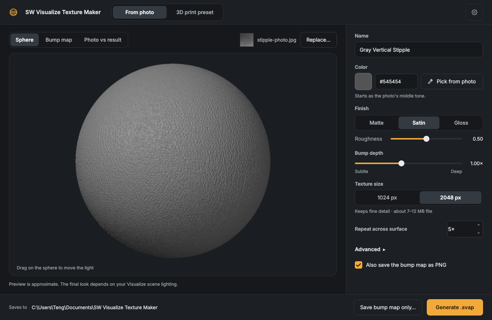
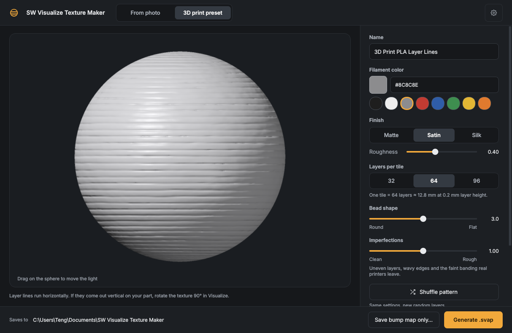

# SW Visualize Texture Maker

Drop a photo of a textured surface, click **Generate**, and get a `.svap` appearance that imports straight into SOLIDWORKS Visualize. There's also a built-in **3D print preset** that makes realistic FDM layer lines with no photo at all.

A free, open-source Windows desktop app.



## Download

Get the latest version from the **[Releases page](https://github.com/TengKo/sw-visualize-texture-maker/releases/latest)**:

- **`SW-Visualize-Texture-Maker-Setup.exe`** (recommended): a normal installer. It adds a Start menu shortcut (and a desktop one if you want), and you can uninstall it from **Settings → Apps**. It installs just for you by default, so no admin rights are needed. To update, run the newer Setup: it replaces the old version and keeps your settings.
- **`SW-Visualize-Texture-Maker-portable.zip`**: no installation. Unzip it anywhere and run the `.exe` inside.

No Python needed. Windows 10 or 11, 64-bit.

> **First launch:** the app isn't code-signed, so Windows SmartScreen may say *"Windows protected your PC"*. Click **More info → Run anyway**. That happens once.

## What it does

### From a photo
1. Drop a photo onto the window (or click **Browse…**).
2. The app evens out the lighting, makes the texture tile seamlessly, and builds a bump (normal) map. This takes a few seconds.
3. Preview it on a sphere (drag to move the light), next to your photo, or as the raw bump map.
4. Adjust the **name, color, finish/roughness, bump depth, texture size** (1024 or 2048 px) and **repeat**.
5. Click **Generate .svap**. Files are saved to `Documents\SW Visualize Texture Maker` by default, and you can change that in Settings.

### 3D print preset
Procedural FDM layer lines: filament color (with quick swatches), finish (matte / satin / silk), layers per tile, bead shape (round to flat), imperfections (clean to rough: uneven layers, wavy edges, Z-wobble banding) and a **Shuffle** button for a new random pattern.



## Using the .svap in Visualize
- Import it into your appearance library, then drag it onto a part.
- **Scale:** if the grain looks too big or too small, change the texture scale/repeat in Visualize, or the *Repeat* value before generating.
- **3D print lines** run horizontally in the texture. If they come out vertical on your part, rotate the texture 90°. On round parts, use planar or cylindrical mapping aligned with the print direction.
- One 3D print tile = *layers per tile* × layer height (64 layers ≈ 12.8 mm at 0.2 mm layers).

## Tips for good photos
- Shoot **straight on**, in **even, soft light** (no hard shadows across the frame).
- Fill the whole frame with the surface: no edges, labels or background.
- 1500 px or more on the short side. Smaller photos work but look softer.

## How it works
- **Photo → height map:** grayscale in linear light, then the lighting gradient is divided out with a large Gaussian blur and local contrast is evened out. The result is cropped square with a margin, and that margin is cross-faded over the opposite edges so the texture tiles without visible seams and without smearing detail. Brightness is used as height.
- **Height → normal map:** wrap-around gradients (so the seams stay invisible), in the **DirectX convention** (green = down), which is what Visualize's own library uses. Bump depth scales the strength.
- **.svap file:** a ZIP (Open Packaging Conventions) holding `Material.xml` (a PBR appearance with one texture in the normal slot), the normal map as an uncompressed DDS, 128 px preview thumbnails, and package metadata. The app copies a template `Material.xml` and changes only the names, IDs, color, roughness, tiling and texture.
- **Advanced:** Settings lets you use your own `.svap` as the template, as long as it has exactly one texture, in the normal-map slot.

## Build from source
Requires Python 3.10+.

```bash
pip install -r requirements.txt
python run.py                       # run the app
pip install -r requirements-dev.txt
python -m pytest -q                 # tests
pyinstaller --noconfirm --clean packaging/texture_maker.spec   # -> dist/SW-Visualize-Texture-Maker.exe
```

On Windows, `build.bat` does all of that in a virtual environment and also builds the installer, `dist/SW-Visualize-Texture-Maker-Setup.exe`. That needs [Inno Setup](https://jrsoftware.org/isinfo.php) (free): `winget install JRSoftware.InnoSetup`. Every push to `main` is built on a Windows machine by GitHub Actions ([workflow](.github/workflows/build.yml)), and the installer is test-installed, self-tested and uninstalled there. Tagged versions (`v*`) are published as releases.

```
texture_maker/
  engine/      photo → height → normal map → .svap (numpy / scipy / Pillow, no Qt)
  ui/          PySide6 desktop UI (pages, widgets, theme, background workers)
  app.py       entry point (+ --self-test used by CI)
tests/         engine tests
packaging/     PyInstaller recipe, Inno Setup installer + build/test scripts
```

## Author
Made by **Teng Maceren** · [tengmaceren.com](https://tengmaceren.com) · [@TengKo](https://github.com/TengKo), built with help from Claude.

## License
[MIT](LICENSE) © Teng Maceren

*Not affiliated with or endorsed by Dassault Systèmes. SOLIDWORKS and SOLIDWORKS Visualize are trademarks of Dassault Systèmes.*
